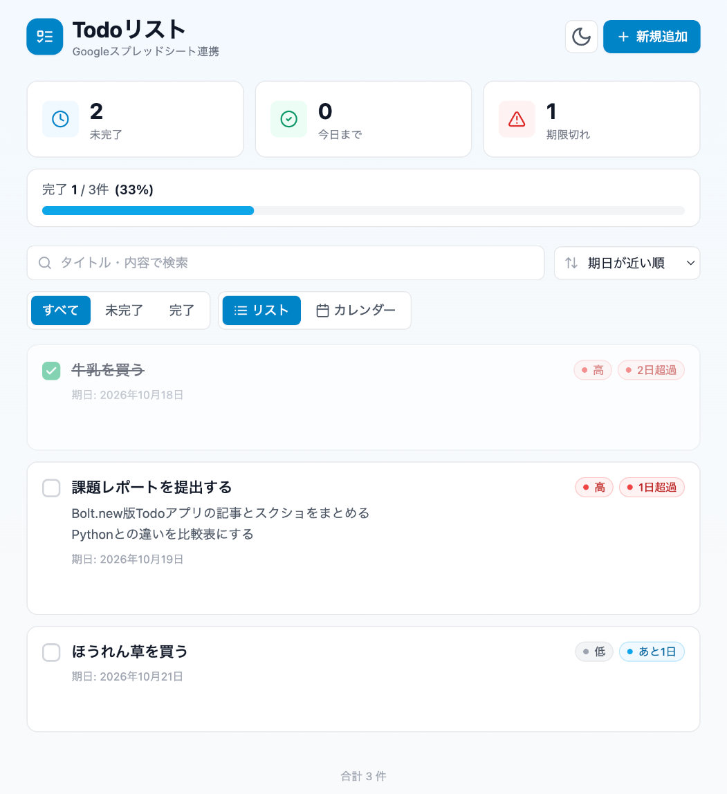
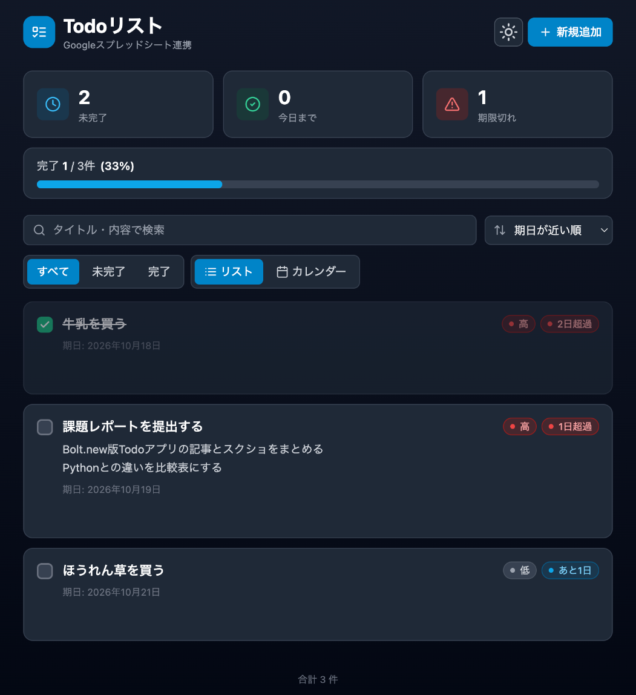
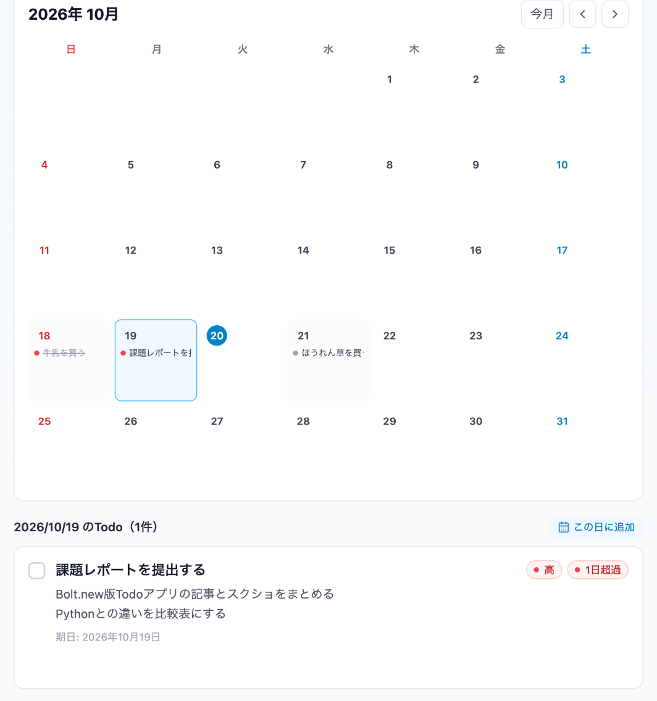
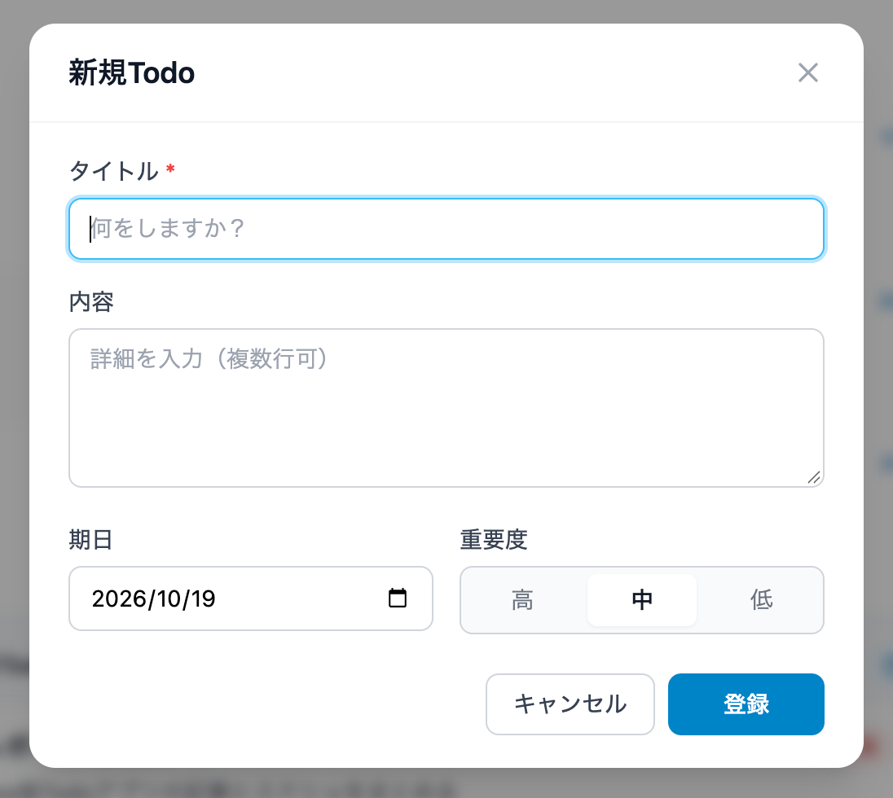
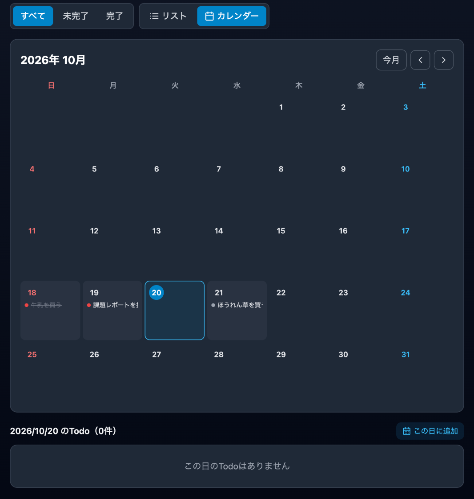

# [課題提出] Todoリストアプリに実用的な機能を3つ追加する実装課題を完成させました

> このファイルは提出記事の控えです（`zsh ~/Projects/テスト/tools/提出記事コピー/copy_article.sh docs` で画像ごとコピーできます）。

## A. 課題概要

### 課題情報

- 課題名：課題7-3 課題1のTodoリストアプリに、実用的な機能を3つ追加しよう
- 難易度：★★☆☆☆（5段階で自己評価）

### 課題要件

- 課題7-3 課題1でBolt.newを使って作ったTodoリストアプリ（JavaScript／React＋Googleスプレッドシート保存）に、実用的な機能を3つ追加する
- 追加した3つの機能
  1. 進み具合のバー：全体のうち何件終わったかを、数字とバーで表示する
  2. ダークモード切り替え：ボタン1つで画面を暗い色に切り替える
  3. カレンダー表示：期日ごとにTodoを月のカレンダーで確認し、日付を選んで追加できる

### ソースコード

- GitHub：https://github.com/Usuke3122378/todo-bolt-plus
- Google Drive：なし
- 公開URL：https://usuke3122378-todo-bo-8yeb.bolt.host

### 成果物のスクリーンショット

進み具合のバー（集計カードのすぐ下。3件中1件完了で33%）

ダークモード（右上の太陽・月のボタンで切り替え）

カレンダー表示（期日の日にTodoのタイトルが並ぶ。19日を押すと、下にその日のTodoが出る）

「この日に追加」を押したときの登録画面（期日に、選んだ日が最初から入っている）

カレンダーのダークモード

## B. 実装内容

### 使用技術

- 言語：TypeScript（JavaScript）、Google Apps Script
- フレームワーク：React、Vite、Tailwind CSS
- データベース：Googleスプレッドシート（課題1のApps Scriptのウェブアプリ経由。今回は変更なし）
- その他ツール：Bolt.new（AIによる開発と公開）、lucide-react（アイコン）、localStorage（ダークモードと表示の切り替えを覚えておく、ブラウザの保存場所）、GitHub（コード保管）、Claude Code（機能の候補出し・指示文の作成・動作確認）

### 実装した機能

1. 進み具合のバー：「完了 1 / 3件（33%）」と数字で表示し、バーが伸び縮みする。100%になると緑色になり「すべて完了！」と出る。0件のときは案内メッセージを出す
2. ダークモード切り替え：ヘッダーのボタンで明るい画面と暗い画面を切り替える。選んだモードは次に開いたときも残る。初回はスマホやパソコンの設定に合わせる
3. カレンダー表示：「リスト／カレンダー」を切り替えられる
    - 月ごとのカレンダーで、「＜」「＞」で前後の月へ、「今月」で今月に戻る
    - 日曜は赤、土曜は青、今日は丸で囲んで表示
    - 期日の日のマスに、重要度の色の点とタイトルを表示（完了したものは取り消し線）
    - 日付を押すと、下にその日のTodoが出て、そのまま完了チェック・編集・削除ができる
    - 「この日に追加」で、期日が入った状態の登録画面が開く
    - 検索と「すべて／未完了／完了」の絞り込みがカレンダーにも反映される。期日のないTodoは「期日なし」として折りたたんで表示

### 工夫したポイント

- 実用性と作りやすさで機能を選んだ：まず課題1のアプリに何がすでにあるかを確認し、まだない機能だけで10個の候補を出してから3つに絞りました。どれも画面だけの変更で、Apps Scriptとスプレッドシートには手を加えずに済みます。
- 課題1を壊さない：課題1のコードをGitHubからBoltに読み込んで、別のプロジェクトとして作りました。課題1の公開URLとリポジトリはそのまま残っています。
- 指示文は1回にまとめた：Boltの無料プランにはトークン（AIが使う文字量）の上限があるため、3つの機能の細かい動きを全部書いた指示文を作って、1回で送りました。
- 「変えないでほしいところ」も書いた：指示文に「Apps Script・api.ts・config.ts は変更しない」「今ある機能は残す」「新しいライブラリは追加しない」と書き、元の機能が壊れないようにしました。
- 好みを覚えておく：ダークモードとリスト／カレンダーの選択を localStorage に保存しているので、開き直しても同じ画面になります。さらに、ページの読み込み前に暗い色を当てるようにして、一瞬だけ白く光るチラつきを防いでいます。
- カレンダーとリストで同じ部品を使う：日付を押したときの一覧は、リスト表示と同じカードを使っているので、完了チェックや編集もそのままできます。

## C. 実装過程

### 開発の流れ

#### 10月20日（1）追加する機能を選ぶ

やったこと：課題1の公開版のコードを確認し、すでにある機能（完了チェック・検索・並び替え・絞り込みタブ・重要度・期日の色分け・集計カード・削除の確認）を整理した。そのうえで、まだない機能だけで10個の候補を出し、「進み具合のバー」「ダークモード」「カレンダー表示」の3つを選んだ。

遭遇したエラー：`（エラーではない）最初に考えた候補10個のうち、完了チェックや検索などの7個が課題1ですでにできていた`

Cursorに聞いた内容：（Claude Code に相談）「公開しているアプリで、まだ実装されていないものをあげてください」

Cursorの回答：（Claude Code の回答）GitHubにある課題1のコードを読んで、すでにある機能とまだない機能を分けた候補を出し直してくれた。

実際に試したこと：

1. 公開URLのコードと見比べて、候補をまだない機能だけにした
    - 結果：カテゴリ・進み具合のバー・元に戻す・ダークモード・CSV書き出し・カレンダー表示など10個がそろった

学んだこと：機能を足す前に、今あるものを確認する。Boltが指示より多めに作ってくれていることがある。

---

#### 10月20日（2）課題1のコードを別プロジェクトとしてBoltに読み込む

やったこと：課題1と同じBoltプロジェクトで公開し直すと、提出済みの課題1のURLの中身まで変わってしまう。そこで、`https://bolt.new/~/github.com/Usuke3122378/todo-bolt` を開いて、GitHubにある課題1のコードを新しいBoltプロジェクトに読み込んだ。

遭遇したエラー：なし

Cursorに聞いた内容：（Claude Code に相談）課題1のURLを残したまま、課題2を作る方法

Cursorの回答：（Claude Code の回答）「bolt.new/~/github.com/ユーザー名/リポジトリ名」の形のURLを開くと、GitHubのコードをBoltに読み込める。

実際に試したこと：

1. URLを開いた
    - 結果：課題1と同じTodo画面が表示され、スプシのデータも読み込めた

学んだこと：GitHubにコードを置いておくと、そこから別のプロジェクトとして続きを作れる。

---

#### 10月20日（3）指示文を1回送って3つの機能を追加

やったこと：3つの機能の動き（どこに置くか、何を表示するか、スマホでの見え方、ダークモードのときの色）を細かく書いた指示文を作り、Boltに1回送った。

遭遇したエラー：なし（修正なしで完成した）

Cursorに聞いた内容：（Claude Code に相談）3つの機能をBoltに頼む指示文を作ってほしい

Cursorの回答：（Claude Code の回答）「変えないところ」も書いたほうがいいとアドバイスされ、Apps Script・api.ts・config.ts を変えないこと、今ある機能を残すこと、新しいライブラリを入れないことを指示文に入れた。

実際に試したこと：

1. Previewで進み具合のバーを確認した
    - 結果：完了チェックを付け外しすると、バーと%がすぐ変わった
2. ダークモードとカレンダーを確認した
    - 結果：暗い画面でも文字が読めた。カレンダーの日付を押すと、その日のTodoが下に出た

学んだこと：指示文に「何を作るか」だけでなく「何を変えないか」を書くと、元の機能が壊れずに済む。

---

#### 10月20日（4）公開とGitHubへの保存

やったこと：右上の Publish から公開し、新しいURL https://usuke3122378-todo-bo-8yeb.bolt.host が発行された。BoltのGitHubボタンから、新しいリポジトリ todo-bolt-plus を作った。

遭遇したエラー：`（エラー表示はなし）リポジトリを作った直後は、中身が init だけで空っぽだった`

Cursorに聞いた内容：（Claude Code に相談）リポジトリの中身が空になっている

Cursorの回答：（Claude Code の回答）BoltのGitHubボタンを押すと「Synced to GitHub」と出ているので、少し待ってからもう一度確認する。

実際に試したこと：

1. 少し待ってから、GitHubのリポジトリを取り直した
    - 結果：「Start repository」というコミットで、src などのコードが全部入っていた
2. 提出記事用のスクショと指示文を docs フォルダに追加した
    - 結果：記事の写真をGitHubのURLで貼れるようになった

学んだこと：BoltからGitHubへの保存は、作った直後ではなく少し遅れて入ることがある。

---

### 参考にした資料

- 公式ドキュメント：
- 参考記事：
- 動画教材：

## D. 学習の振り返り

### 今回学んだこと

技術的な学び：

- Tailwind CSS は `darkMode: 'class'` にすると、html に dark クラスを付けるだけで、`dark:` を付けた色に切り替わる
- localStorage を使うと、サーバーやスプシを使わずに、ブラウザに小さな設定を覚えさせられる
- カレンダーは、1日が何曜日かと、その月が何日まであるかが分かれば、ライブラリなしで作れる
- 進み具合や「今日」「期限切れ」の数は、スプシから取ってきた一覧をもとに画面側で計算している

AIツールの使い方：

- 指示文に「変えないところ」まで書くと、元の機能が守られる
- 細かい動きまで1回の指示文にまとめると、Boltの無料枠でも修正なしで完成できる
- 機能を足す前に、AIに今のコードを読んでもらい、すでにあるものを確認すると無駄がない

開発の進め方：

- 提出済みの課題は、GitHubから別プロジェクトとして読み込んで続きを作ると、元を壊さずに済む
- 画面だけで完結する機能を選ぶと、Apps Scriptやスプシを触らずに済むので、失敗しても戻しやすい

### 作った機能からの発展アイデア

今回作った機能：期日ごとにTodoを月のカレンダーで見られる機能

発展アイデア：「カレンダーの日付にTodoをドラッグして、期日を変えられるようにする」

### 次の課題に向けて

- スマホでは編集・削除ボタンが、マウスを乗せたときだけ表示される作りのままなので、常に表示されるように直したい
- 期日が近いTodoを、毎朝メールで知らせる機能（Apps Scriptの時間で動く設定）にも挑戦したい
- カテゴリ（仕事・家事・買い物など）のように、スプシの列を増やす機能も作ってみたい

---

📝 追加メモ

- 課題1の公開URL（https://react-spreadsheet-to-3kdr.bolt.host）とリポジトリ（todo-bolt）は、課題1の提出時のまま残しています
- データの保存先（Apps Script とスプレッドシート）は課題1と同じものを使っています
- Boltに送った指示文は [docs/bolt-prompt.md](https://github.com/Usuke3122378/todo-bolt-plus/blob/main/docs/bolt-prompt.md) にあります
